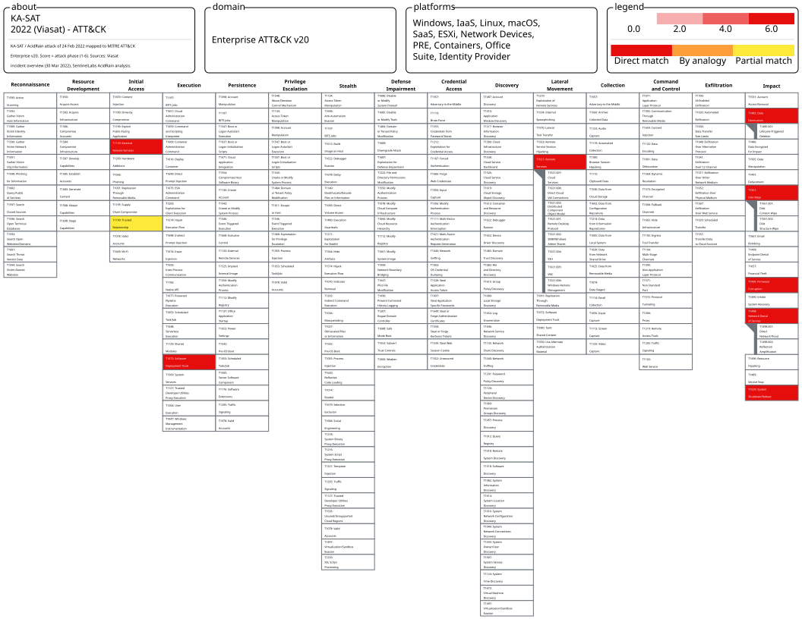

# KA-SAT (Viasat) 2022 Attack: SPARTA & MITRE ATT&CK Mapping

> Portfolio project analysing a real-world space-sector cyber incident with the SPARTA and MITRE ATT&CK frameworks.
>
> **Framework versions:** SPARTA v4.0.1 (24 Aug 2026) · MITRE ATT&CK Enterprise v20

## 1. Executive summary

On 24 February 2022, about an hour before Russia's invasion of Ukraine, attackers disrupted one consumer partition of the KA-SAT satellite broadband network (operated for Viasat by Eutelsat subsidiary Skylogic).
Several thousand customers in Ukraine and tens of thousands across Europe lost service; the spillover cut remote monitoring of about 5,800 Enercon wind turbines in Germany.
The attacker got in through a misconfigured VPN appliance, moved into the trusted management segment, and used legitimate management commands to run the AcidRain wiper on the modems, while a DoS from modems in Ukraine degraded the network.
Viasat found no evidence that the satellite or its ground infrastructure was compromised. The management plane was the single point of failure, and the user terminals trusted it completely.
**Key lesson:** in a SATCOM network the management plane is the crown jewel. Remote access, segmentation, command authorisation and terminal firmware integrity matter as much as the space link.

## 2. Attack timeline

| Time (UTC) | Event | Source |
| --- | --- | --- |
| Before 24 Feb 2022 (not disclosed) | Initial access via misconfigured VPN appliance | Viasat |
| Before / on 24 Feb (not disclosed) | Lateral movement into the trusted management segment | Viasat |
| 24 Feb, ~03:02 | High volumes of focused malicious traffic from SurfBeam2/2+ modems and/or CPE located in Ukraine (targeted DoS) | Viasat |
| 24 Feb, ~03:02 – several hours | Operators force malicious modems offline, but new ones keep joining the attack | Viasat |
| 24 Feb, ~03:02 – ~04:15 | Gradual decline in the number of modems online in the same partition | Viasat |
| 24 Feb, ~04:15 – ~05:00 | Larger numbers of modems across much of Europe exit the network over ~45 minutes and do not try to reconnect (effect of destructive management commands / AcidRain overwriting flash memory) | Viasat, SentinelLabs |
| 24 Feb, following hours | ~5,800 wind turbines in Germany lose remote monitoring | UK NCSC |
| 24 Feb – early Mar | Network largely stabilised within hours, fully within several days; some modems fixed by over-the-air updates, nearly 30,000 replacement modems shipped | Viasat |
| 15 Mar 2022, 15:08 | AcidRain sample (`ukrop`, 32-bit MIPS ELF) first seen on VirusTotal, uploaded from Italy | SentinelLabs |
| 30 Mar 2022 | Viasat publishes incident overview (VPN misconfiguration, management commands) | Viasat |
| 31 Mar 2022 | SentinelLabs publishes AcidRain analysis; Viasat later confirms AcidRain was used | SentinelLabs |
| 10 May 2022 | EU, UK and US formally attribute the attack to Russia; Estonia names the GRU | EU, UK FCDO, US DoS |

## 3. SPARTA mapping

| # | Phase | SPARTA technique | Evidence |
| --- | --- | --- | --- |
| 1 | Initial access via VPN | IA-0007 Compromise Ground System | Viasat: attacker exploited a misconfigured VPN appliance to gain remote access to the trusted management segment |
| 2 | Lateral movement | PER-0003 Ground System Presence; LM-0007 Credentialed Traversal (by analogy) | Viasat: lateral movement within the trusted management segment |
| 3 | Legitimate-looking commands | IA-0007.02 Malicious Commanding via Valid GS (by analogy); IMP-0007 Native Functionality Abuse — vector: Disable (by analogy) | Viasat: legitimate, targeted management commands sent to many modems simultaneously. SPARTA IA-0007.02: the distinguishing feature is that command origin appears valid, so the first execution is a misuse of legitimate command authority, not a protocol anomaly (written for spacecraft, hence by analogy). SPARTA v4: a legitimate function used for a harmful purpose is Native Functionality Abuse |
| 4 | User terminals targeted | IA-0009.03 Trusted Relationship: User Segment (partial — reverse direction) | Modems trusted the provider's management plane and executed its commands |
| 5 | AcidRain wiper | IMP-0012 Software, Firmware, or Programmable Logic Manipulation — vector: Disable; IMP-0010 Data Manipulation (file deletion step) — vector: Disable (by analogy) | SentinelLabs: AcidRain deletes files, wipes flash/storage devices and reboots, rendering devices inoperable. Viasat: modems unable to access the network but recoverable by factory reset, which matches SPARTA's Disable definition (temporary or permanent, destructive or non-destructive) |
| 6 | DoS from modems | IMP-0013 Resource Exhaustion or Contention — vector: Subvert (by analogy) | Viasat: malicious traffic from modems in Ukraine made it hard for legitimate modems to enter or stay on the network. This is contention for a shared resource that degraded service without fully removing it, so Subvert fits better than Disable |

_Verified against SPARTA v4.0.1 (IA-0007, IA-0007.02, ST0009 Impact, LM-0007 pages). In v4.0 the Impact tactic uses **mechanism techniques** (IMP-0007 to IMP-0014) plus **Impact Vectors** (Collect, Pivot, Subvert, Seize, Disable); IMP-0001 to IMP-0006 are deprecated. SPARTA allows one action to map to more than one Impact technique._

_Navigator layer: [`layers/sparta-layer.json`](layers/sparta-layer.json) (open it in the [SPARTA Navigator](https://sparta.aerospace.org/navigator)) · screenshot: TODO_

## 4. MITRE ATT&CK mapping

| # | Phase | ATT&CK technique |
| --- | --- | --- |
| 1 | Initial access via VPN | T1133 External Remote Services |
| 2 | Lateral movement | T1021 Remote Services |
| 3 | Mass management commands | T1072 Software Deployment Tools |
| 4 | User terminals targeted | T1199 Trusted Relationship (provider → customer devices) |
| 5 | AcidRain wiper | T1485 Data Destruction, T1561 Disk Wipe, T1495 Firmware Corruption, T1529 System Shutdown/Reboot |
| 6 | DoS from modems | T1498 Network Denial of Service |

### AcidRain at a glance (SentinelLabs)

| Item | Detail |
| --- | --- |
| File | `ukrop` — ELF 32-bit MSB, MIPS-I, statically linked, stripped |
| SHA256 | `9b4dfaca873961174ba935fddaf696145afe7bbf5734509f95feb54f3584fd9a` |
| Step 1 (if root) | Recursive overwrite and delete of non-standard files in the filesystem → T1485 |
| Step 2 | Brute-forces storage device files (`/dev/sd*`, `/dev/mtdblock*`, `/dev/block/mtdblock*`, `/dev/mtd*`, `/dev/mmcblk*`, `/dev/block/mmcblk*`, `/dev/loop*`, index 0–99): overwrites up to 0x40000 bytes or, for `/dev/mtd*`, erases via `MEMGETINFO`, `MEMUNLOCK`, `MEMERASE`, `MEMWRITEOOB` IOCTLs; `fsync` to commit → T1561, T1495 |
| Step 3 | Redundant reboot attempts → device inoperable → T1529 |
| Design | Generic "one-binary-fits-all" wiper, not tailored to the SurfBeam2 firmware |
| Overlap | ~55% tlsh similarity and shared MEM* IOCTL logic with VPNFilter stage 3 `dstr` plugin (medium confidence) |

_Navigator layer: [`layers/attack-layer.json`](layers/attack-layer.json) (open it in the [ATT&CK Navigator](https://mitre-attack.github.io/attack-navigator/))_

## 5. Detection opportunities (SOC view)

| Phase | What a SOC could have seen |
| --- | --- |
| 1. Initial access via VPN | VPN logins from unusual geolocations/ASNs or at odd hours; authentication to an account that should not have remote access; configuration changes or anomalies on the VPN appliance; access that bypasses MFA |
| 2. Lateral movement | New east-west connections from the VPN pool into the management segment; first-time use of admin protocols (SSH, RDP, management APIs) between hosts; credential use on hosts the account never touched before |
| 3. Mass management commands | A single operator/session issuing commands to thousands of modems in seconds; commands outside a change window or without a matching change ticket; use of file-push/execute functions that are rarely used in normal operations |
| 4. User terminals targeted | Unusual modem configuration or firmware pushes to a whole region (e.g. all Ukrainian beams) at once; deviation from the normal per-customer command pattern |
| 5. AcidRain wiper | Execution of an unknown binary on terminals via the management plane; mass reboot events; large numbers of terminals failing to re-register on the network; loss of telemetry from devices that were healthy minutes earlier. Forensics: flash overwritten with a repeating pattern of 4-byte integers counting down from `0xffffffff`; known SHA256 of `ukrop` |
| 6. DoS from modems | Sudden spike in upstream traffic (SYN-flood-like patterns) from residential terminals; NetFlow anomalies per beam; degraded hub capacity |

## 6. Countermeasures

NIST and ISO columns show the most relevant controls selected by the analyst, not the full SPARTA control mapping.

| Phase | SPARTA CM | NIST 800-53 Rev5 | ISO 27001:2022 |
| --- | --- | --- | --- |
| 1. Initial access via VPN | CM0005 Ground-based Countermeasures; CM0031 Authentication; CM0023 Configuration Management | AC-17, IA-2(1), CM-6, RA-5 | A.8.5, A.8.9, A.8.8 |
| 2. Lateral movement | CM0038 Segmentation; CM0039 Least Privilege; CM0035 Protect Authenticators | SC-7, AC-4, AC-6, IA-5 | A.8.22, A.8.2, A.5.17 |
| 3. Mass management commands | CM0054 Two-Person Rule; CM0055 Secure Command Mode(s); CM0052 Insider Threat Protection (all three mapped by SPARTA to IA-0007.02) | AC-3(2), AC-6(9), AU-6 | A.5.3, A.8.15, A.8.16 |
| 4. User terminals targeted | CM0055 Secure Command Mode(s) (by analogy: SPARTA defines it for onboard spacecraft command acceptance; applied here to terminal-side authorisation of high-risk commands); CM0039 Least Privilege | AC-3, AC-6, SI-10 | A.8.2, A.8.18 |
| 5. AcidRain wiper | CM0014 Secure Boot; CM0056 Data Backup (golden image / recovery partition); CM0090 Continuous Monitoring | SI-7, CP-9, CP-10, CA-7 | A.8.13, A.8.16, A.5.30 |
| 6. DoS from modems | CM-NA (no SPARTA CM addresses DoS directly); CM0070 Alternate Communications Paths (resilience) | SC-5, SI-4, CP-8 | A.8.20, A.8.16, A.5.30 |

_Note: code signing of firmware updates (CM0021) would not have stopped this attack. Viasat found no tampering with firmware images and no use of the normal update process; the damage came from legitimate management commands._

## 7. Open questions & limitations

- No full public forensic report from Viasat.
- **Exact VPN misconfiguration not disclosed:** Viasat and Skylogic declined to publish further details, citing mitigation actions. It is unknown whether the cause was a missing patch, weak or stolen credentials, or an exposed management interface.
- **"Supply chain" or not? Reconciling the two sources:** SentinelLabs proposed that the attacker abused the KA-SAT management mechanism "in a supply-chain attack" to push a wiper. Viasat states there is no evidence that firmware images were tampered with, that the standard update process was used, or of any supply-chain interference. Viasat later confirmed that SentinelLabs had identified the destructive executable "run on the modems using a legitimate management command". The two accounts fit together: the vendor's firmware supply chain was not compromised, but the operator's management plane was abused to run a malicious binary. That is why this analysis uses T1072 Software Deployment Tools rather than T1195 Supply Chain Compromise. The exact commands are still not public.
- **"Destructive" but recoverable:** Viasat says the modems were made unable to access the network but not permanently unusable; they can be restored with a factory reset. Recovery still needed OTA updates or replacement hardware at scale.
- **Third-party operator:** the affected partition was operated by Skylogic (Eutelsat) under a transition agreement after Viasat bought the business in April 2021. Shared responsibility during an ownership transition is a plausible contributing factor, but it is not confirmed.
- **Attribution limits:** governments attributed the attack to Russia, and Estonia named the GRU. The AcidRain–VPNFilter `dstr` link is assessed by SentinelLabs at *medium* confidence only (55% tlsh similarity, likely shared compiler, shared MEM* IOCTLs); SentinelLabs says it cannot definitively tie AcidRain to VPNFilter or Sandworm.
- **DoS mechanism unknown:** SentinelLabs notes it is hard to see how legitimate commands alone would produce the DoS from modems. Neither source explains how the modems in Ukraine were made to generate the malicious traffic.
- **Role of the DoS:** some researchers suggest the DoS was meant to distract engineers from the wiper deployment. This is an assessment, not a confirmed fact.
- **SPARTA coverage gap:** IA-0007 (Compromise Ground System) explicitly lists "front-end processors and modems" among ground-system assets, but frames the compromise as the most direct path to first execution against a spacecraft. In KA-SAT the initial access matches (VPN → management network), but the satellite itself was never touched; the target was the user terminals. The mapping is therefore by analogy, which is why this analysis also uses MITRE ATT&CK.
- **SPARTA Lateral Movement scope:** LM-0007 (Credentialed Traversal) describes reusing legitimate credentials to cross trust boundaries toward more privileged onboard subsystems or neighbouring spacecraft, e.g. from "constellation management planes to individual vehicles". Movement between hosts inside a ground network is not described, so LM-0007 is applied by analogy and ATT&CK T1021 covers the actual behaviour. Two further caveats: (1) Viasat does not say credentials were used for the lateral movement, so "Credentialed" is an assumption; (2) the closest real parallel is the next step, where one management plane reached thousands of terminals, much like a constellation management plane reaching individual vehicles.
- **Impact scope:** SPARTA Impact techniques and vectors are written for effects on a spacecraft or space-system element. The KA-SAT modems are user-segment elements, so IMP-0007, IMP-0010, IMP-0012 and IMP-0013 are applied by analogy.
- **DE-0004 Masquerading considered and rejected:** the technique describes forging or imitating an authorized origin. In KA-SAT the commands came from the real (compromised) management system, so only the effect matches, not the method. IA-0007.02 covers this case better: SPARTA defines it as the use of a compromised, mission-owned ground system to send legitimate-looking commands whose origin appears valid.
- **Reverse trust direction:** SPARTA IA-0009.03 describes a compromised user terminal as a springboard *into* the provider and spacecraft. KA-SAT shows the opposite path: a compromised provider management plane used *against* thousands of user terminals that trusted it. This provider-to-customer direction is not explicitly modelled in SPARTA.
- **SPARTA v4.0 ground segment guidance:** v4.0 added ground segment defense guidance (six mission areas, including Mission Operations Center and Ground Networking Services), and CM0005 now points to it. The KA-SAT management segment fits the Ground Networking Services / MOC areas, so the defensive side of the ground segment is now better covered than the attack-technique side.
- **SPARTA countermeasure gap for DoS:** no SPARTA countermeasure directly addresses rate limiting or resource exhaustion, so phase 6 relies on NIST SC-5 and ISO controls.
- **Dwell time unknown:** Viasat has not disclosed when the attacker first gained access. A pre-positioned foothold, held until 24 Feb, is plausible but unconfirmed.
- **Why destroy instead of persist? (assessment):** the timing suggests the objective was disruption of communications at the start of the invasion, not intelligence collection. Viasat itself believes the purpose was to interrupt service and found no evidence that end-user data was accessed. A wiper makes the outage last (modems had to be replaced or reflashed) and destroys forensic evidence, at the cost of "burning" the access.

## 8. Sources

- [Viasat: KA-SAT Network cyber attack overview](https://www.viasat.com/perspectives/corporate/2022/ka-sat-network-cyber-attack-overview/)
- [SentinelLabs: AcidRain, A Modem Wiper Rains Down on Europe](https://www.sentinelone.com/labs/acidrain-a-modem-wiper-rains-down-on-europe/)
- [CISA/FBI AA22-076A: Strengthening Cybersecurity of SATCOM Network Providers and Customers](https://www.cisa.gov/uscert/ncas/alerts/aa22-076a)
- [UK Government: Russia behind cyber-attack with Europe-wide impact an hour before Ukraine invasion](https://www.gov.uk/government/news/russia-behind-cyber-attack-with-europe-wide-impact-an-hour-before-ukraine-invasion)
- [BleepingComputer: Viasat confirms satellite modems were wiped with AcidRain](https://www.bleepingcomputer.com/news/security/viasat-confirms-satellite-modems-were-wiped-with-acidrain-malware/)
- [The Record: Western powers blame Russia for Ukraine satellite hack](https://therecord.media/eu-uk-blame-russia-for-ukraine-satellite-hack/)
- [Aerospace America: Why the Viasat hack still echoes](https://aerospaceamerica.aiaa.org/features/why-the-viasat-hack-still-echoes/)
- [SPARTA](https://sparta.aerospace.org) (v4.0.1) · [SPARTA Countermeasures](https://sparta.aerospace.org/countermeasures/SPARTA) · [Ground Segment Cyber Defenses](https://sparta.aerospace.org/countermeasures/ground-segment-cyber-defenses) · [Impact tactic ST0009](https://sparta.aerospace.org/tactic/ST0009)
- [The Aerospace Corporation: SPARTA v4.0 — Breaking New Ground](https://medium.com/the-aerospace-corporation/sparta-v4-0-breaking-new-ground-b2d3b7ab832f)
- [MITRE ATT&CK](https://attack.mitre.org)
